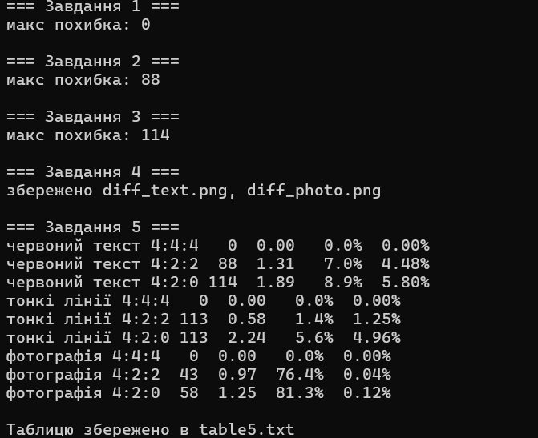

# Лабораторна робота 5 — Субдискретизація кольору

**Дисципліна:** Розробка мультимедійних застосунків
**Спеціальність:** 122 Комп'ютерні науки, група КН-3/1
**Автор:** Василевич Дмитро
**Мова та бібліотеки:** Python, NumPy, Pillow, scikit-image, matplotlib

## Мета

Власноруч реалізувати субдискретизацію кольору (схеми 4:2:2 і 4:2:0), побудувати карти різниці й поміряти, на яких зображеннях проріджування кольору дає помітну похибку, а на яких ні.

## Що зроблено

1. **Завдання 1.** Перетворення RGB → YCbCr → RGB. Максимальна похибка на фотографії дорівнює 0, тобто саме перетворення нічого не псує.
2. **Завдання 2.** Схема 4:2:2: усереднення пар сусідніх значень Cb і Cr по горизонталі та повторення назад.
3. **Завдання 3.** Схема 4:2:0: усереднення квадратів 2×2 і повторення назад.
4. **Завдання 4.** Карти різниці для червоного тексту і для фотографії (яскравість = найбільша похибка серед трьох каналів, підсилена ×2).
5. **Завдання 5.** Таблиця вимірювань для трьох зображень і трьох схем.

Яскравість Y не проріджується ніколи, економія виходить лише за рахунок Cb і Cr.

## Запуск

```powershell
python lab5.py
```

Скрипт створює файли `text422.png`, `text420.png`, `lines420.png`, `diff_text.png`, `diff_photo.png` і `table5.txt`. Для малювання напису потрібен шрифт із кирилицею (використовується DejaVu Sans Bold, який іде разом із matplotlib).

## Файли

| Файл | Призначення |
| --- | --- |
| `lab5.py` | Уся програма: перетворення, схеми 4:2:2 і 4:2:0, карти різниці, вимірювання |
| `text422.png` | Червоний напис: зверху оригінал, знизу після 4:2:2 |
| `text420.png` | Те саме для 4:2:0 |
| `lines420.png` | Тонкі лінії: оригінал, 4:2:2 і 4:2:0 поруч |
| `diff_text.png` | Карта різниці для червоного напису (4:2:0, ×2) |
| `diff_photo.png` | Карта різниці для фотографії (4:2:0, ×2) |
| `table5.txt` | Таблиця вимірювань |


**Примітка про червоний текст.** Для червоного напису максимальна похибка (88 і 114) трохи відрізняється від контрольних значень (87 і 123). Причина в тому, що краї букв малюються залежно від версії Pillow і FreeType, а похибка рахується саме на краях. Решта таблиці збігається з контрольною.

## Карти різниці

На картах яскравість дорівнює найбільшій похибці серед трьох каналів, **помноженій на 2**, щоб слабкі похибки було видно. Без множника карти виглядали б майже чорними.

- `diff_text.png`: похибка зібралася на контурах букв.
- `diff_photo.png`: майже суцільно чорне поле, помітних відмінностей немає.

## Висновки

Схема одна й та сама, код той самий, а результат протилежний. У фотографії змінилося 81,3 % пікселів, але помітних змін лише 0,12 %: сусідні кольори схожі, і усереднення майже нічого не псує. У червоного тексту змінилося менше пікселів (8,9 %), зате на різких краях між червоним і чорним зміни великі, і помітними є понад дві третини з них. Тому субдискретизація кольору підходить для фотографій, а для дрібного кольорового тексту й тонких ліній шкодить.

## Відповіді на запитання

**1. Скільки чисел зберігається на квадрат 2×2 пікселі? Який відсоток обсягу економить кожна схема?**
У 4:4:4 це 12 чисел (4 Y + 4 Cb + 4 Cr). У 4:2:2 це 8 чисел (4 Y + 2 Cb + 2 Cr), економія третина, тобто 33 %. У 4:2:0 це 6 чисел (4 Y + 1 Cb + 1 Cr), економія половина, тобто 50 %.

**2. Чому проріджують саме Cb і Cr, а не Y? Що станеться, якщо прорідити Y?**
Око набагато краще бачить дрібні деталі яскравості, ніж дрібні деталі кольору. Якщо прорідити Y, зображення стане розмитим і втратить різкість, і це буде помітно одразу. Якщо прорідити Cb і Cr, різкість лишається, а колір на фотографії зазвичай змінюється непомітно.

**3. Де зібралася похибка на карті різниці і чому саме там?**
На контурах букв. Там сусідні пікселі сильно різняться за кольором (червоний і чорний), тому усереднення Cb і Cr змішує їх: букву «заливає» за край, а тло трохи червоніє. Всередині букв і на чорному тлі сусіди однакові, середнє дорівнює їм самим, тож похибка нульова.

**4. У фотографії змінилося 81 % пікселів, у тексту 9 %. Чому зіпсованим виглядає текст?**
У фотографії зміни дрібні, бо сусідні кольори схожі, тому помітна різниця (понад 30) лише у 0,12 % пікселів. У тексту змінених пікселів менше, але вони стоять на різких краях, і зміни великі, тож помітними є 5,8 % пікселів, тобто дві третини всіх змін. Важливо не скільки пікселів змінилося, а наскільки сильно.

**5. Чим 4:2:2 відрізняється від 4:2:0 за напрямком усереднення? Яку лінію 4:2:2 не зіпсувало і чому?**
У 4:2:2 усереднюються пари сусідів по горизонталі, у 4:2:0 квадрати 2×2, тобто ще й по вертикалі. Горизонтальні лінії схема 4:2:2 не зіпсувала: усі пікселі пари лежать в одному рядку і мають однаковий колір, тому усереднення нічого не змінює. А в 4:2:0 горизонтальна лінія завтовшки 1 піксель змішується з рядком над нею або під нею, тому колір розпливається.

**6. Скріншот програми з дрібним кольоровим текстом: який формат обрати?**
Формат без втрат, наприклад PNG. Якщо потрібен JPEG, то лише з вимкненою субдискретизацією (4:4:4), бо схема 4:2:0 розмиває колір на краях дрібного тексту.
