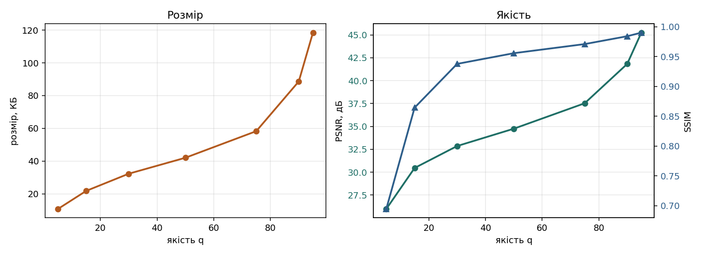

# Лабораторна робота 6 — JPEG-lite

**Дисципліна:** Розробка мультимедійних застосунків
**Спеціальність:** 122 Комп'ютерні науки, група КН-3/1
**Автор:** Василевич Дмитро
**Мова та бібліотеки:** Python, NumPy, Pillow, scikit-image, matplotlib

## Мета

Зібрати власний кодер зображень за схемою JPEG без останнього (ентропійного) кроку: DCT 8×8, квантування з коефіцієнтом якості, зворотний хід. Побудувати криву «розмір / PSNR / SSIM» і визначити власний поріг видимості артефактів.

## Що зроблено

1. **Завдання 1.** Матриця базису DCT `D` (8×8), пряме `dct2 = D @ block @ D.T` і зворотне `idct2 = D.T @ coeffs @ D`. Похибка туди й назад близько 1e-13.
2. **Завдання 2.** Таблиця квантування `qtable(q)`: базова таблиця Q50, помножена на коефіцієнт `S` (`5000/q` при q < 50, `200 − 2q` при q ≥ 50), округлення, обмеження 1…255. При q = 50 збігається з Q50.
3. **Завдання 3.** `encode` (віднімання 128, розбиття на блоки, DCT, ділення на таблицю, округлення, `int16`) і `decode` (множення на таблицю, зворотне DCT, склеювання, додавання 128, обрізання до 0…255).
4. **Завдання 4.** Крива якості для семи значень q і порівняння з розміром справжнього JPEG.
5. **Завдання 5.** Власний поріг видимості на фотографії та на зображенні іншого типу (скріншот).

## Запуск

```powershell
pip install numpy pillow scikit-image matplotlib
python lab6.py
```

Спочатку виконуються тести (усі мають бути `[OK]`), потім будується крива якості й зберігаються `q95.png … q05.png` та `curve.png`.

Для другого зображення (скриншот `my.png` у цій же папці) запускається `second.py`: він зберігає результати в підпапку `second`.

## Файли

| Файл | Призначення |
| --- | --- |
| `lab6.py` | Заготовка з заповненими чотирма TODO, тести, крива якості |
| `second.py` | Прогін другого зображення (скріншот) через той самий кодер |
| `q95.png` … `q05.png` | Відновлені зображення при різних якостях (фотографія) |
| `curve.png` | Крива «розмір / PSNR / SSIM» |
| `second/` | Результати для другого зображення |

## Результати: фотографія (вбудоване зображення 512×512)

Сирий розмір 262 144 байти. Контрольні тести пройдено, числа збігаються з контрольною таблицею.

| q | Байт | Стиснення | Нулів | PSNR | SSIM | JPEG, байт |
| --- | --- | --- | --- | --- | --- | --- |
| 95 | 121 316 | 2,2× | 61,8 % | 45,2 | 0,990 | 84 983 |
| 90 | 90 773 | 2,9× | 72,4 % | 41,8 | 0,984 | 58 760 |
| 75 | 59 655 | 4,4× | 82,6 % | 37,5 | 0,971 | 35 144 |
| 50 | 43 018 | 6,1× | 87,6 % | 34,7 | 0,956 | 24 288 |
| 30 | 33 028 | 7,9× | 90,5 % | 32,9 | 0,938 | 18 282 |
| 15 | 22 284 | 11,8× | 93,6 % | 30,5 | 0,864 | 12 389 |
| 5 | 10 937 | 24,0× | 96,8 % | 26,0 | 0,695 | 6 817 |



Від q = 95 до q = 50 файл меншає майже втричі, а SSIM падає лише з 0,990 до 0,956. Нижче q = 30 економія невелика, зате SSIM різко падає (0,938 → 0,695). Робочий діапазон для фотографій приблизно від 40 до 80.

## Власний поріг видимості

Порівняння проводилось у масштабі 100 % з оригіналом.

| Зображення | Поріг (перша якість, де видно різницю) | PSNR | SSIM |
| --- | --- | --- | --- |
| Фотографія | **q = 30** | 32,9 дБ | 0,938 |
| Скріншот (`my.png`) | **q = 75** | XX,X дБ | 0,XXX |

> ⚠️ **Заповни:** PSNR і SSIM для скріншота при q = 75 візьми з виводу `python second.py` (рядок `75`).

**Висновок про поріг.** На фотографії різницю з оригіналом я вперше помітив при q = 30, а на скріншоті з різкими краями й текстом уже при q = 75, тобто поріг змістився в бік вищої якості. Причина в тому, що різкі краї й дрібний текст складаються з високочастотних коефіцієнтів DCT, які квантування викидає першими, і навколо букв з'являється «брижа» та розмиття. Плавні переходи у фотографії описуються низькими частотами, які квантування майже не чіпає, тому артефакти там непомітні довше.

**Головне питання звіту.** Поріг залежить і від типу зображення, і від людини, тому одне число PSNR не може бути вимогою до стиснення. У технічному завданні потрібно вказувати якість окремо для кожного типу вмісту (наприклад, для фотографій близько 50, для скріншотів із текстом не нижче 90) і перевіряти її на реальних прикладах замовника.

## Відповіді на запитання

**1. У якому рядку втрачається інформація? Чому до нього втрат немає?**
У рядку `np.round(dct2(b) / Q)` в `encode`: після ділення на таблицю й округлення дрібні коефіцієнти стають нулями, і їх уже не відновити. Усе до цього рядка оборотне: віднімання 128 і DCT нічого не гублять (похибка туди й назад близько 1e-13, це похибка дробових чисел, а не алгоритму). Після нього розкладання ще можна відновити з похибкою, але самі округлені числа вже не повернуться.

**2. DCT не зменшує кількість чисел (після нього теж 64). У чому користь?**
DCT перескладає інформацію так, що майже вся вона збирається в кількох коефіцієнтах у лівому верхньому куті, а решта виявляється малою. Після цього їх можна викинути майже без втрат для зображення, і саме нулі добре стискаються. Сам DCT нічого не стискає, він готує дані до квантування.

**3. Що фізично змінює повзунок якості? Покажи на таблицях при q = 90 і q = 15.**
Повзунок змінює лише числа в таблиці квантування: базову таблицю Q50 множать на `S`. При q = 90 `S = 20`, і числа в таблиці малі (середнє близько 12), тому виживає багато коефіцієнтів. При q = 15 `S ≈ 333`, і таблиця більша втричі з гаком (числа обмежені 255), тому майже всі коефіцієнти округляються в нуль і лишається лише кілька.

**4. Чому числа в таблиці зростають до правого нижнього кута?**
У лівому верхньому куті живуть повільні великі візерунки, до яких око чутливе, тому там числа малі й точність висока. У правому нижньому куті дрібна брижа, до якої око майже нечутливе, тому там числа великі й ці коефіцієнти викидаються сміливіше.

**5. Чому наш файл при q = 50 майже вдвічі більший за справжній JPEG, хоч якість та сама?**
Картинки однакові, різниця лише в упаковці нулів. Ми стискаємо коефіцієнти через zlib у «сирому» порядку по рядках, а справжній JPEG складає 64 числа зигзагом від лівого верхнього кута, щоб усі нулі зібралися в один довгий хвіст, і кодує його RLE та Хаффманом. Наш файл 43 КБ проти 24 КБ у справжнього JPEG.

**6. Назви свій поріг видимості й PSNR на ньому. Чому поріг сусіда інший?**
Мій поріг на фотографії q = 30, PSNR 32,9 дБ. Зображення те саме, але люди дивляться по-різному: різна гострота зору, монітор, яскравість, на що саме звертає увагу той, хто порівнює. PSNR і SSIM це формули, а не очі, тому вони не можуть бути єдиною межею прийнятної якості.

**7. Зображення для сайту: яку якість обрати і як обґрунтувати замовникові?**
Для фотографій я б узяв q близько 75 (стандартний вибір редакторів). За моєю кривою від q = 95 до q = 75 файл меншає майже вдвічі, а SSIM падає всього з 0,990 до 0,971, тобто економія майже безкоштовна. Нижче q = 30 економія невелика, а якість різко падає. Для скріншотів із текстом і різкими краями якість треба брати вищою (не нижче 90), бо там артефакти помітні раніше.
